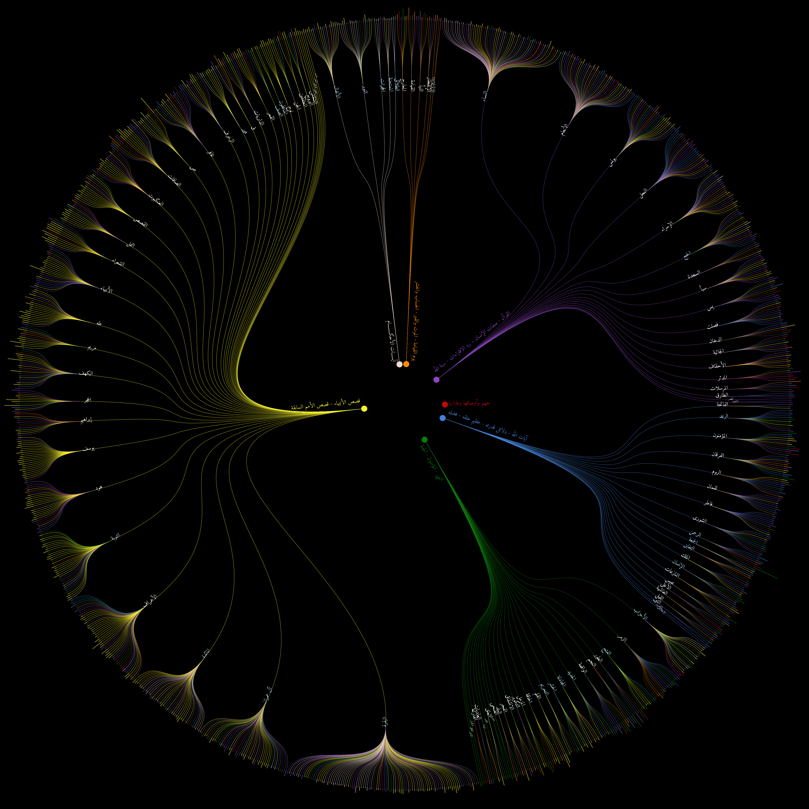

# تمثيل بصري وتصنيف باستخدام النماذج اللغوية لموضوعات القرآن الكريم
حظي القرآن الكريم باهتمام العاملين بمجال معالجة اللغة العربية، ومن ضمن التطبيقات المهمة في مجال معالجة اللغة تصنيف آيات القرآن الكريم إلى الموضوعات التي تنتمي إليها الآيات. تقدم هذه الورقة محاولة جديدة – غير مسبوقة فيما نعلم- تغطي ثلاث موضوعات هي: أولا، تمثيل بصري جديد ومفيد يربط مجموعة من الآيات المتتابعة التي تنتمي إلى موضوع معين (بحسب البيانات التي لدينا) مع سور القرآن الكريم التي وردت فيها مما يساعد بسرعة على معرفة الموضوعات التي تركز عليها السور الكريمة. وتقدم الورقة ثانيا اختبارا لخمسة نماذج لغوية كبيرة تعتمد تقنية "بيرت" لتصنيف مجموعة معطاة من الآيات إلى واحد من التصنيفات الموجودة في البيانات المستخدمة. وتشير نتائج الاختبار إلى تفوق نموذج بيرت الكبير العربي وتحقيقه 70% على مقياس إف-1. والسبب في هذه النتيجة غير الممتازة هو أن أحد التصنيفات ضم موضوعات متنوعة. ثم تقدم الورقة ثالثا تطبيقا على هذا التصنيف لآيات القرآن الكريم لمعرفة موضوعات خطب الجمعة. وتشير النتائج التي تحصلنا عليها إلى نجاعة هذه الطريقة في معرفة موضوعات الخطب وإمكانية تطبيقها على نصوص من مجالات شرعية أخرى. وفي أعمالنا القادمة سوف نسعى للبحث عن تصنيفات أكثر دقة وتفصيلا للحصول على نتائج أفضل.

</img>

# المرجع
عبدالرحمن المحارب، عبدالمحسن الثبيتي، علي عريشي، إيمان الخنين (2024). تمثيل بصري وتصنيف باستخدام النماذج اللغوية لموضوعات القرآن الكريم. المؤتمـــر السنوي الثالث لمجمع الملك سلمــان العالـمي للغـــة العربية - حوسبة اللغة العربية وإثراء البيانات اللغوية. الرياض.

# QuranTopics
Quran Topics Visualization Project
